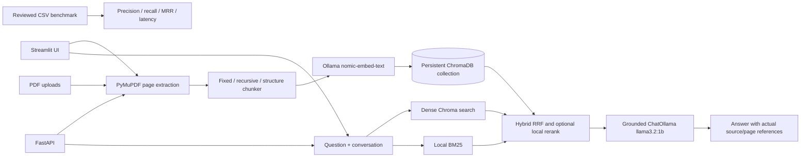

# DocuMind AI — Local Research & Document Intelligence

DocuMind indexes text PDFs on the user's computer, retrieves evidence from ChromaDB, and answers with Ollama. It supports configurable fixed, recursive, and heading-aware chunking, dense retrieval, BM25, reciprocal-rank hybrid retrieval, optional local LLM reranking, citations, conversation history, research summaries, comparisons, and a FastAPI service.

**No OpenAI API is used.** OCR is not included; image-only PDFs are reported as unsupported. Do not treat the current project as a validated research benchmark until a reviewed document corpus and ground-truth dataset have been added and evaluated.

## Architecture



Business logic is in `rag/`; `app.py` and `backend/main.py` are presentation/API adapters. Conversation turns live in Streamlit session state and are not stored in Chroma.

## Requirements

- Windows 10/11, Python 3.10 or 3.11, Git optional, Ollama installed and running.
- Answer model `llama3.2:1b`; embeddings `nomic-embed-text`.
- For useful local reranking and summaries, the same answer model is used. This is a small model and can miss nuanced evidence.
- PDFs must contain selectable text. OCR is not implemented.

## Install and run on Windows PowerShell

```powershell
cd C:\RAG-Document-Assistant
py -3.11 -m venv .venv
.\.venv\Scripts\Activate.ps1
python -m pip install --upgrade pip
pip install -r requirements.txt
Copy-Item .env.example .env
ollama serve
```

In a second terminal (Ollama may already start as a Windows service):

```powershell
ollama pull llama3.2:1b
ollama pull nomic-embed-text
ollama list
streamlit run app.py
```

The API can be run separately:

```powershell
uvicorn backend.main:app --host 127.0.0.1 --port 8000
```

Open API docs at `http://127.0.0.1:8000/docs`. Streamlit's default is `http://localhost:8501`.

## Configuration and embedding migration

`.env.example` lists the local model URL and model names. `.env` is ignored by Git. `CHROMA_COLLECTION` optionally changes the active collection name; the default is `rag_documents_nomic_embed_text_v1`. Each collection records its embedding model and the app refuses a mismatch. Existing `rag_documents` vectors are not automatically reused or deleted. To switch embedding model, choose a new collection name and reprocess PDFs; preserve a copy of `vector_db/` before any manual cleanup. Recreate the old collection only after confirming which model created it. Never change a model label to make incompatible vectors appear compatible.

Document identity is SHA-256 of PDF bytes. Reprocessing updates current chunk IDs and removes stale chunks for that PDF after the new chunks are added. Deleting through the Streamlit document manager removes matching vectors and the saved local PDF after confirmation. The API delete route removes vectors only; it does not delete local files.

## Features

- **Dashboard**: upload several PDFs, choose chunk strategy/size/overlap, see processing progress and indexed chunk previews, ask grounded questions.
- **Retrieval**: dense Chroma, local BM25, hybrid reciprocal-rank fusion; optional local ChatOllama reranking. Top-k is configurable. Reranking is an experimental model-based ordering, not a cross-encoder benchmark.
- **AI Chat**: session-only multi-turn history and local standalone follow-up rewriting.
- **Documents**: list, reprocess, and delete indexed files.
- **Research**: summaries, structured research-paper analysis (title/objective/problem/method/dataset/algorithms/results/limitations/future work), and candidate questions. Fields not evidenced should be marked unavailable by the model; verify important outputs manually.
- **Compare**: evidence-grounded comparison of selected documents.
- **Settings**: Ollama status, model names, vector path and counts.
- **FastAPI**: `/health`, `/health/ollama`, `/documents`, `/documents/upload`, `/documents/{source}`, `/documents/{source}/reprocess`, `/ask`, `/summarize`, `/research-analysis`, `/questions`, `/compare`, `/evaluation`.

## Validation and tests

```powershell
python -m compileall -q app.py rag backend evaluation tests
pytest -q
python -c "from rag.generator import INSUFFICIENT, generate_answer; from backend.main import app; print(INSUFFICIENT); print(app.title)"
```

Local model integration (requires both models):

```powershell
ollama list
python -c "from rag.embeddings import ensure_ollama_ready, get_embedding_model; ensure_ollama_ready(); print(len(get_embedding_model().embed_query('local test')))"
```

Upload a small text-based PDF in the UI, ask a question whose answer is visibly present, inspect filename/page citations, then verify the no-evidence response with an unrelated question. Test delete and reprocess from Documents. API smoke test:

```powershell
Invoke-RestMethod http://127.0.0.1:8000/health
Invoke-RestMethod http://127.0.0.1:8000/health/ollama
Invoke-RestMethod -Method Post http://127.0.0.1:8000/ask -ContentType 'application/json' -Body '{"question":"What does the document say?","method":"hybrid","k":5}'
```

Tests requiring installed local models are not equivalent to the offline unit tests. Do not expose this local service to an untrusted network without adding authentication, rate limits, and deployment security controls.

## Evaluation protocol

Create 30–50 *human-verified* rows in `evaluation/dataset_template.csv`: question, expected answer, expected source basename, expected one-based page, and a concise exact evidence span. Keep the source PDFs and dataset versioned only if licensing permits. Then run:

```powershell
python -m evaluation.evaluate --dataset evaluation/dataset_template.csv --methods dense bm25 hybrid --k 5
python -m evaluation.evaluate --dataset evaluation/dataset_template.csv --methods hybrid --k 5 --answers
```

The first command writes measured Precision@K, single-target Recall@K, MRR, evidence/citation match and retrieval latency to `evaluation/reports/`. `--answers` adds answer latency and explicitly labeled lexical faithfulness/relevance proxies; these are not RAGAS scores or reliable semantic judgments. There are no preloaded questions or claimed results. The current CSV schema has a single expected source/page per question; extend it for multiple relevant sources before reporting general recall. Run separate clean collections and report corpus/configuration when comparing chunking strategies, because each chunking change requires reindexing.

## Research context and limits

- Lewis et al., [Retrieval-Augmented Generation for Knowledge-Intensive NLP Tasks](https://arxiv.org/abs/2005.11401) (2020): combines a parametric generator with a retrieved non-parametric memory and studies knowledge-intensive NLP tasks. This project is a conventional retrieve-then-prompt pipeline, not the paper's trained end-to-end RAG model.
- Karpukhin et al., [Dense Passage Retrieval for Open-Domain Question Answering](https://aclanthology.org/2020.emnlp-main.550/) (2020): trains a dual-encoder retriever and evaluates passage retrieval. DocuMind's Ollama embeddings are off-the-shelf and do not reproduce DPR training or benchmarks.
- Asai et al., [Self-RAG](https://arxiv.org/abs/2310.11511) (2023/2024): trains reflection tokens for adaptive retrieval and self-critique. DocuMind does not implement that trained method.
- Es et al., [RAGAS](https://arxiv.org/abs/2309.15217) (2023): proposes reference-free evaluation metrics involving model-based judgments. The optional lexical proxies here are not RAGAS.
- Yan et al., [Corrective Retrieval Augmented Generation](https://arxiv.org/abs/2401.15884) (2024): uses a retrieval evaluator to trigger corrective actions. DocuMind does not reproduce CRAG and does not send local documents to web search.

Experimental proposal: freeze a permitted set of PDFs and 30–50 manually checked questions; stratify answerable/unanswerable and cross-document questions; vary chunk strategy, size, overlap, retriever, top-k and reranking one factor at a time; run each setup in its own Chroma collection; report retrieval metrics, citation correctness, answer faithfulness/relevance judgments, latency and hardware/model versions. Double-review a sample of judgments and publish raw anonymized question IDs plus scripts. Do not claim hybrid or reranking is superior unless paired results support it.

## GitHub publishing checklist

Initialize a repository only after reviewing file contents; commit `.env.example`, source, tests, docs, and an empty dataset template. Keep `.env`, `vector_db/`, uploads, PDFs, virtual environments, and logs out of commits. Search staged files for credentials and licensed documents. Add a license appropriate to the project's dependencies and your own code. GitHub commands after review:

```powershell
git init
git add .
git status --short
git diff --cached
git commit -m "Upgrade DocuMind local RAG platform"
git branch -M main
git remote add origin https://github.com/<account>/<repository>.git
git push -u origin main
```

## Portfolio / interview summary

**Resume:** Built DocuMind, a local-first PDF research assistant with PyMuPDF ingestion, configurable chunking, Ollama embeddings and generation, persistent ChromaDB, dense/BM25 hybrid retrieval, local reranking, citation display, conversational follow-ups, document comparison, FastAPI endpoints, and a ground-truth evaluation harness.

**Interview explanation:** Explain the page-level metadata pipeline, embedding-model isolation by collection, deterministic chunk IDs/upsert and stale-chunk cleanup, dense-vs-BM25 tradeoffs, reciprocal-rank fusion, prompt-injection boundaries, provenance citations, and evaluation limitations. Present measured results only after building the labeled corpus and running the scripts; describe Ollama availability and hardware as deployment dependencies.
